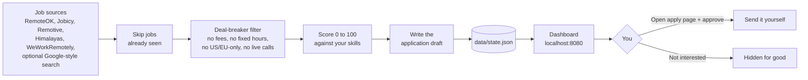
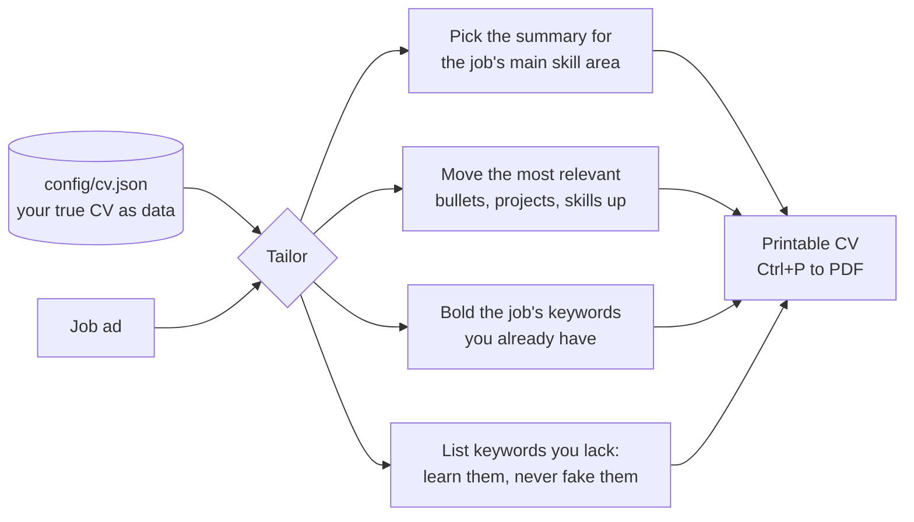

# Remote Job Hunter

A small Java program that **finds remote jobs for you, throws away the bad ones, scores the rest against your skills, writes the application, and hands it to you to send in one click.**

No Maven, no libraries, no accounts needed. Only Java 21.

## The big idea

Applying for jobs is 90% the same boring loop: *look → check → decide → write → send.* A computer is great at the first four. The last one (sending) is where you want a human, because blind auto-apply gets accounts banned and walks you into scams.

So the program does the heavy lifting and **you only press one button per job.**



Think of it like a kitchen: the program is the prep cook (washes, chops, plates). You are the chef who tastes it and sends it out.

## Quick start

```bash
# 1. Put your details in place (first time only)
cp config/profile.example.json config/profile.json
cp config/cv.example.json config/cv.json
#    fill in both files with your own, true details

# 2. Build (needs Java 21)
./build.sh            # Windows: build.bat

# 3. Check your setup and which job sites you can reach
java -jar jobhunter.jar doctor

# 4. Run it: searches every 3 hours and serves the dashboard
./start.sh            # Windows: start.bat
#    then open http://localhost:8080
```

Other commands:

| Command | What it does |
|---|---|
| `doctor` | Checks your setup and which job sites are reachable |
| `run` | One search now, then stop |
| `serve` | Dashboard only |
| `daemon --every-hours 3` | Dashboard plus automatic searching (what `start.sh` runs) |
| `top --n 15` | Prints the best jobs in the queue |

## Using the dashboard

- **Queue**: new jobs, best score first. Each card shows why it scored well, any warnings, and a ready-made application.
- **Approve and send**: edit the draft if you like, click *Open apply page*, paste it in, then click *I applied*.
- **Applied / Approved / Hidden**: your tracking, so you never apply twice.
- **Block employer**: one click, never see them again.
- **Platforms to join**: a checklist of sign-up sites (DataAnnotation, Outlier, Mindrift, Upwork, Preply and more) where AI-training and tutoring work comes from. These need an account, so you join them once by hand.

## A tailored CV for every job

Recruiters skim a CV in seconds, and most companies run it through an ATS (software that scans for the job's own words). So for each job the tool builds a CV just for it:



- Each job card shows a **CV keyword match** (for example 80%) and the words your CV is missing.
- Click **Tailored CV**, then press Ctrl+P and choose *Save as PDF*.
- It **never invents** anything. It only re-orders and highlights what is in `config/cv.json`.
- Blanks left as `__` (such as missing dates) are flagged in red on screen until you fill them in.

## LinkedIn, Indeed, ZipRecruiter, Google Jobs and Handshake

These sites block programs from reading their pages, and their rules forbid scraping. So the tool works with them in honest ways:

1. **One-click searches.** The *Job boards* tab lists your 20 target titles, each with LinkedIn, Indeed, ZipRecruiter and Google Jobs links for recent, remote jobs.
2. **Paste a job.** Found one you like? Paste the title and description. It is scored, checked for deal-breakers, and gets a draft and a tailored CV.
3. **Automatic daily search** (with a Brave or Serper key): it asks the search engine for LinkedIn, Indeed and ZipRecruiter job pages from the past week, one query per target title, best-fit titles first.
4. **Google Jobs** (with a `SERPAPI_KEY`): Google has no free jobs feed, so SerpApi's Google Jobs API is used. Jobs older than 7 days are dropped.
5. **Handshake** only works through a partner university (mostly US and UK). It is on the *Platforms to join* checklist: ask your careers office if your university is on it.

ZipRecruiter is mostly US jobs, so many of its "remote" roles are US-only and get screened out by your deal-breakers. Wonderin AI is a paid CV-tailoring tool, not a job board; the *Tailored CV* button does the same job for free.

Your 20 target titles live in `targetTitles` in `config/profile.json`. A job whose title matches one gets +8 points.

## Make it yours

Everything is in `config/profile.json`:

- `skillGroups`: keywords and proof lines for each skill. **Edit the proof lines so every claim is true for you.**
- `dealBreakers`: switch each one on or off.
- `minHourlyUsd`: minimum pay per work type.
- `scoreThreshold`: lower it to see more jobs, raise it to see fewer.
- `fx`: approximate exchange rates for pay comparison.

## Google-style web search (optional)

Google closed its Custom Search API to new customers, so the program uses a replacement. Set **one** of these and the web search turns on:

```bash
export BRAVE_API_KEY=...     # Brave Search API
export SERPER_API_KEY=...    # Serper (Google results)
export SERPAPI_KEY=...       # optional: turns on Google Jobs
```

Optional: `ANTHROPIC_API_KEY` lets Claude polish drafts for the best-scoring jobs.

## Honest limits

- **It does not send applications for you.** That is deliberate: blind auto-apply gets accounts banned and leads to scams.
- It cannot sign up to platforms for you. Joining is a one-time job for you.
- Scores are a guide, not a promise. Read each job before applying.
- Pay conversion uses fixed approximate exchange rates.
- Free job feeds change their format now and then. If a source breaks, the program logs it and carries on with the others.

## For developers

Zero dependencies, JDK only (`java.net.http`, `com.sun.net.httpserver`, `javax.xml`).

```bash
./build.sh test    # compiles and runs 195 offline checks
```

```
src/main/java/jobhunter/
  Sources.java    fetch + parse each job feed
  Filter.java     deal-breakers and scam signals
  Scorer.java     skill matching and scoring
  Drafter.java    application text
  Cv.java         CV as data, keyword match, tailored printable CV
  Pipeline.java   ties it all together
  Store.java      state in data/state.json
  Dashboard.java  local web UI (loopback only)
```

The dashboard only listens on your own computer, checks the Host header, and requires a custom header on every change, so other websites cannot drive it.
